# Invoicerr landing - Visual guide

Annotated screenshots of the home page after the i18n, pricing and illustrations work, one per
point of the brief. Taken on the production build (`npm run build && npx vite preview`) with the
`app-screenshots` skill (agent-browser plus its annotation script), 1440 × 900 unless noted.
The local price shots use a stored rate (the Worker endpoint is not deployed yet): $1.16 and
¥8.21 for one euro.

**URL:** http://localhost:4173 (build of `feat/i18n-pricing-illustrations`)
**Date:** 2026-11-03

---

## 1. Fifteen languages

The French page: the **menu** (1) is translated, the **headline** (2) stays in English on every
page, and **Join the waiting list** (3) goes straight to the French waiting list.

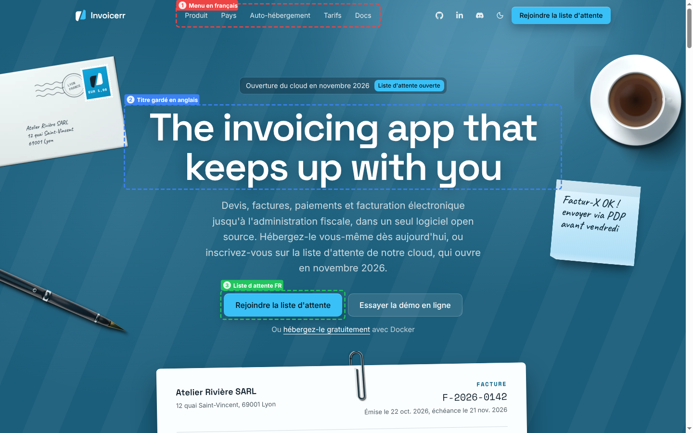

The footer lists the **fifteen languages** (1). A reader whose browser prefers another of them
gets a **dismissible note** (2) in that language; nobody is redirected.

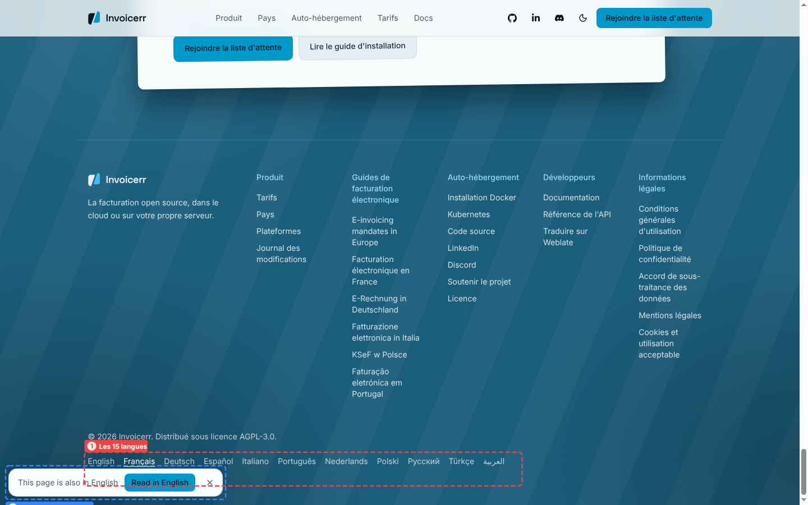

Arabic reads **right to left** (1), and the **sample invoice** (2) is translated, with its
amounts in the page's locale.

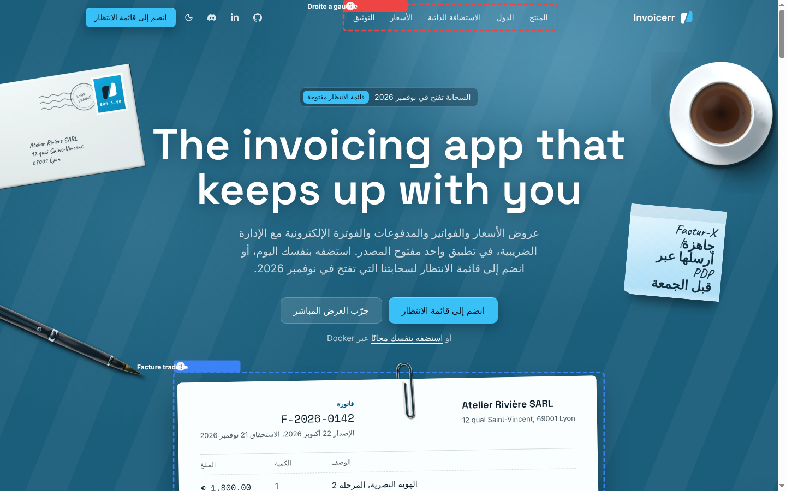

## 2. Unslop pass

The **status badge** (1) is in sentence case instead of tracked capitals, and the **headline**
(2) has no trailing period.

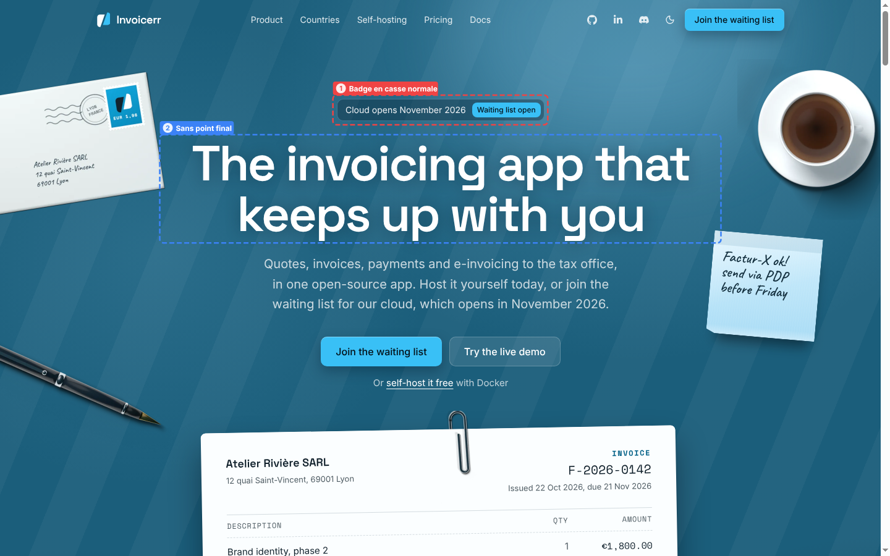

Section **labels** (1) lose their tracked capitals, **headings** (2) their trailing period.

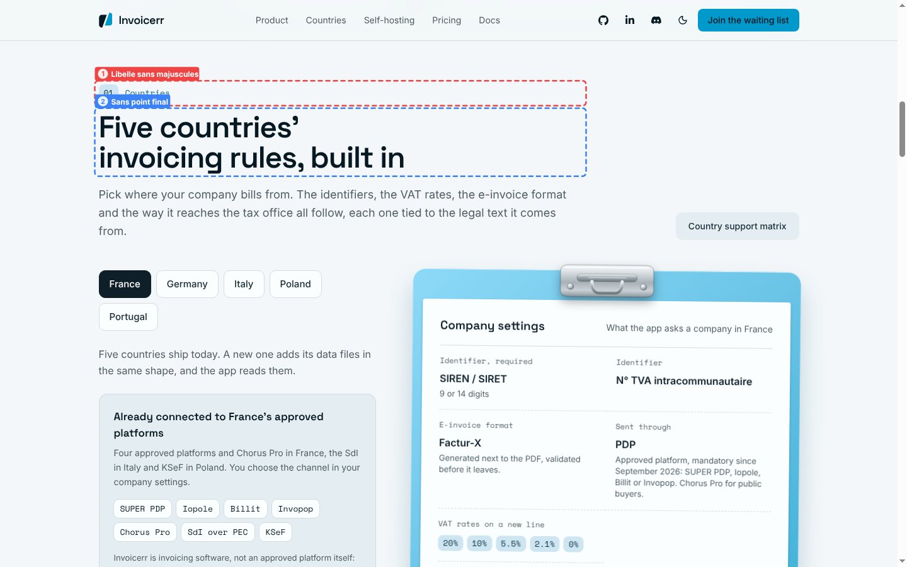

The last call to action keeps **one primary and one secondary button** (1), down from three.

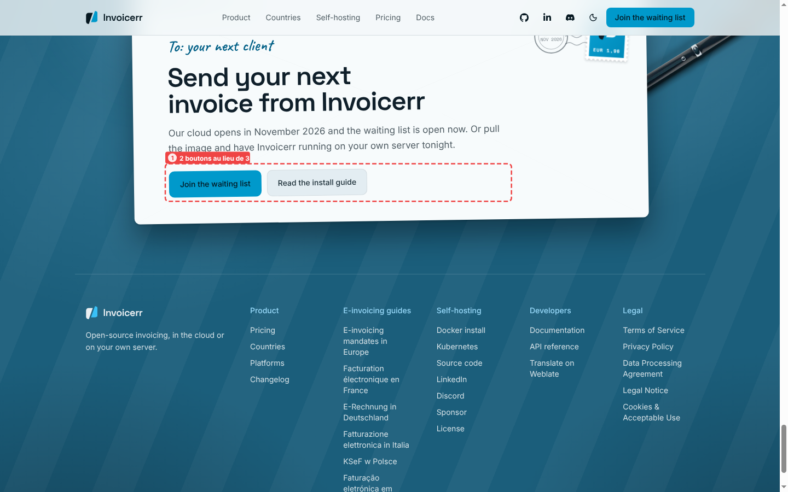

## 3. Illustrations instead of icons

Blender renders lying on the cards: the **stamp and ink pad** (1), the **stopwatch** (2), the
**keys** (3)...

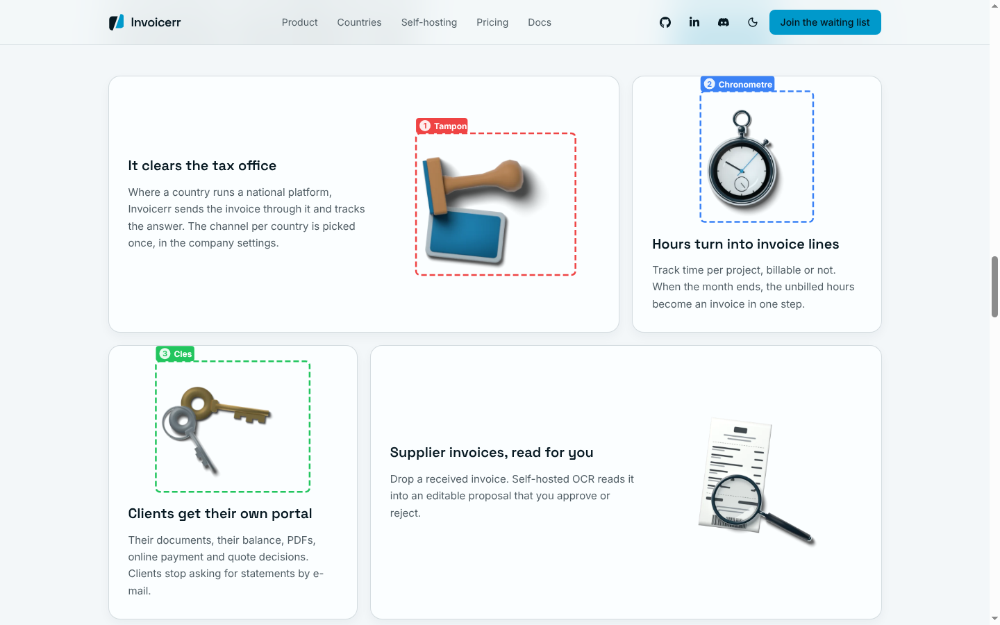

...the **magnifier on a receipt** (1), the **USB-C cable** (2) and the **banknotes** (3).

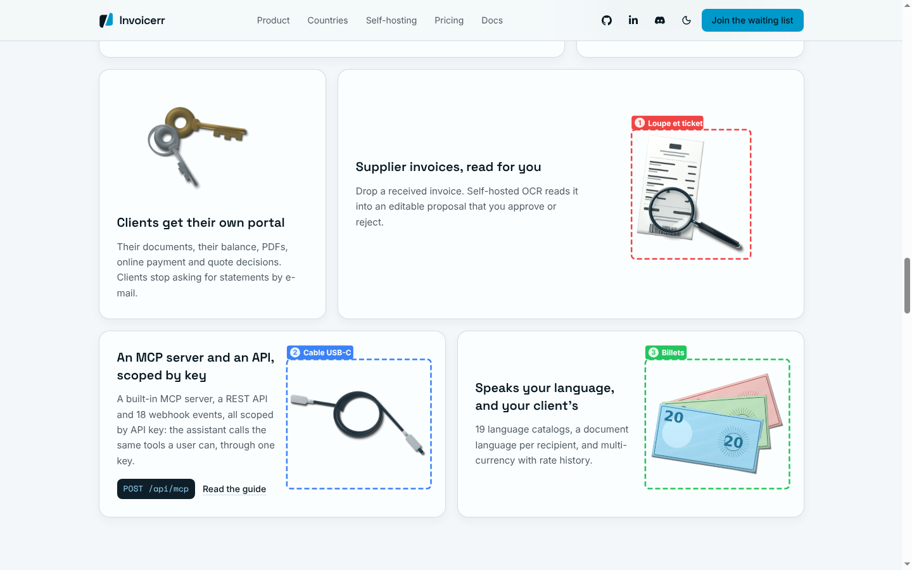

## 4. Pricing readability

Yearly carries a **−17 % badge** (1), the **monthly price crossed out** (2) next to the monthly
equivalent, and the **bill line by line** (3).

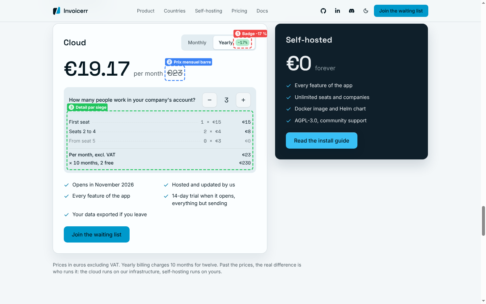

## 5. Local price

A visitor in the United States reads the **price in dollars** (1), with one line saying it is
converted from euros at the ECB's rate.

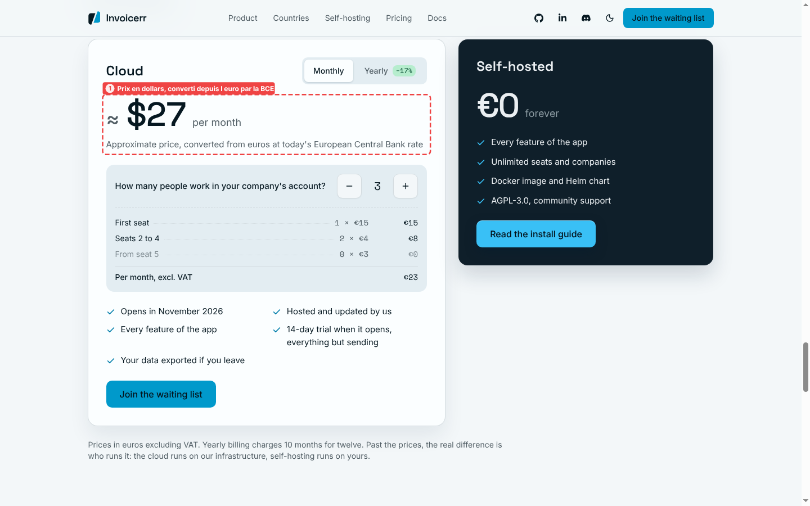

The same card on a phone, in Chinese, for a visitor in China (iPhone 14 emulation).

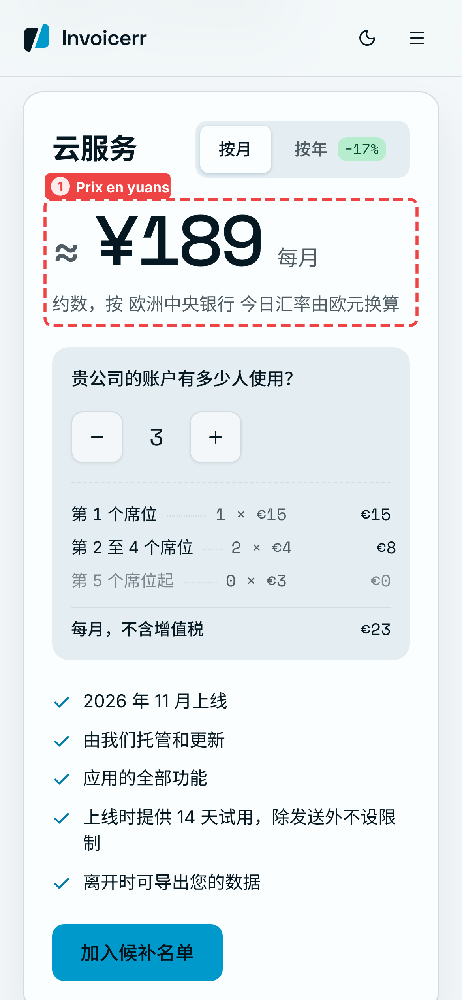

## 6. Humanizer, one skill per language

French, after `humanizer-fr`: the **portal card** (1) now reads « Ils ne vous demandent plus leurs
relevés par e-mail » instead of « Fini les demandes de relevé de compte par e-mail ».

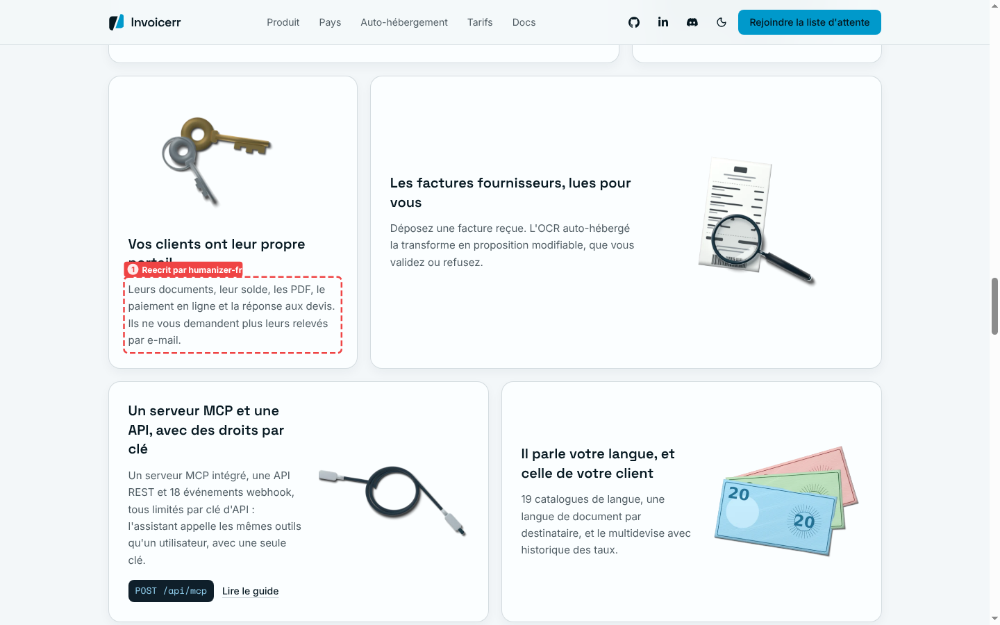

German, after `humanizer-de`: « Eingangsrechnungen, für Sie gelesen » became
**« Eingangsrechnungen per OCR erfasst »** (1), and the API card title lost its English sentence
shape (2).

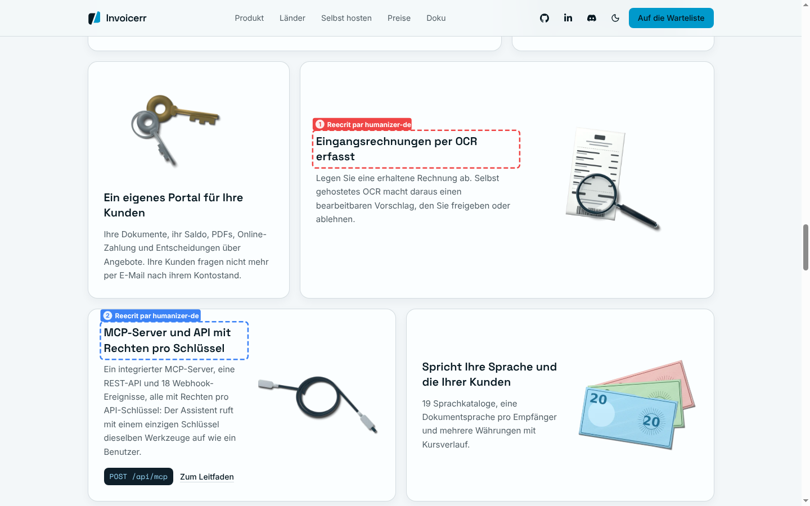
